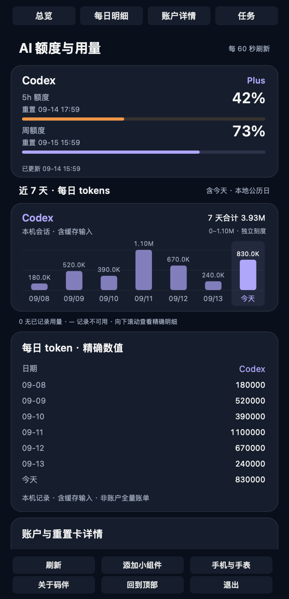
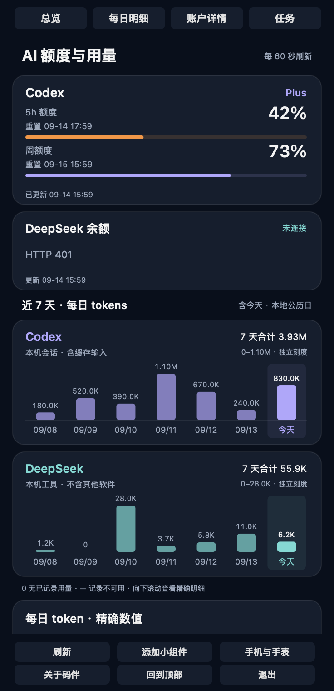
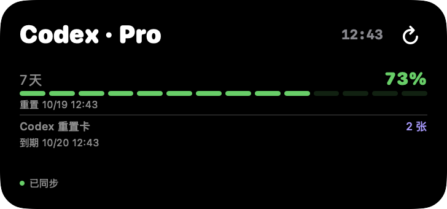
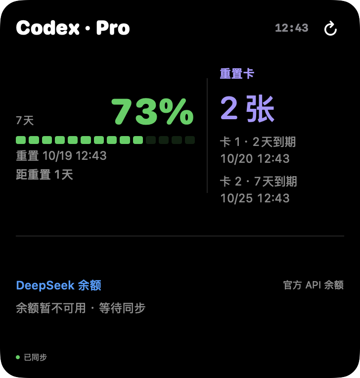

# 纯 Codex 适配 · v3.5.0-beta.2

2026-10-18。DeepSeek 为可选服务，未配置时不要求用户配置或显示余额占位。Mac 菜单栏、主面板、趋势与每日明细、iPhone 和 Watch 首页、账户总览组件、经典组件与表盘组件统一按配置状态显示。移除配置后的下一次成功采样会收起相关区域；离线期间仍保留上次快照。

- 缺少 DeepSeek 数据或状态为 `not_configured`：隐藏。Mac 使用现有「未配置 API Key」状态识别未配置；空初始快照也不展示余额。
- 已配置但查询失败：保留异常区域，不伪装为零余额或未配置；Codex 数据继续独立显示。
- 正常零余额：仍显示。
- 表盘纯 Codex 模式保留重置时间、百分数、独立进度条；缓存提示独立保留。

## 验证

- 全部 192 项 Python 测试与 85 项共享 Swift 测试通过，含配置状态切换、错误保留、零余额和缓存/重置边界。
- `bash macos/scripts/check.sh` 通过：解析、组件数据、公开文件检查、Mac 构建、签名及 App Group 一致性。
- iPhone 与 watchOS 模拟器目标构建通过，包含手机及手表组件。
- 原生 AppKit 离屏渲染覆盖未配置、正常、查询失败；校验面板高度、分区导航与刷新后滚动位置。
- SwiftUI 组件离屏渲染核对纯 Codex 与错误态。下图均为本项目原生视图、虚构数据，非真机截图。
- 2026-10-18 发布后验收：最新版已安装至 Mac、iPhone 和 Apple Watch（含表盘组件），手机／手表安装回执均成功，原配对与应用数据保留。临时停用 DeepSeek 后，用户确认三端纯 Codex 布局显示正常。
- 验收后原 DeepSeek 配置已恢复，Mac 与移动端接口余额读取正常；未把接口恢复等同于设备端恢复布局的视觉验收。
- 后台刷新时效、低亮常显和真实账号网络故障实验未单独验收；现有展示图仍为离屏演示。

| 纯 Codex | 已配置但失败 |
|---|---|
|  |  |
|  |  |
